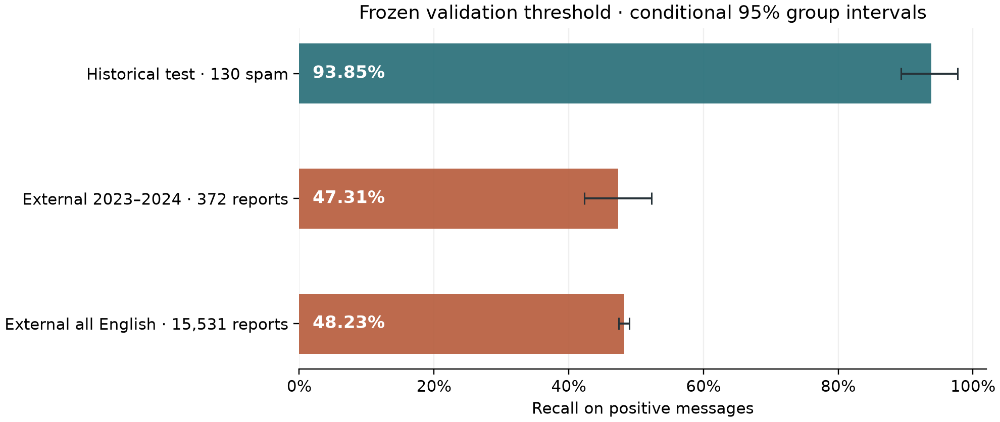

# External evaluation on reported SMS

The frozen word TF-IDF LinearSVC detected **176 of 372** eligible English
messages with an explicit 2023–2024 year: **47.31% recall**, with 196 missed
reports and a conditional 95% group-bootstrap interval of **42.32–52.28%**.
This is substantially lower than its 93.85% recall on 130 historical test spam
messages. The contrast includes changes in source, message type, sampling and
pseudonymization; it is not a causal estimate of deterioration over time.



The external dataset contains positive reports only. No external precision, F1,
accuracy, false-positive rate or ROC-AUC is claimed. The two external cohorts
overlap, and the intervals condition on the fixed model and observed groups.

## Source and independence

We use the author-released artifact for Agarwal et al., *Fishing for Smishing*,
ACM IMC 2025, licensed CC BY 4.0.
[Publication](https://doi.org/10.1145/3730567.3764431) ·
[Pinned dataset](https://github.com/reportsmishing/Smishing-Dataset-IMC25/tree/a6175560b57387199871e51fbef6bc523d2516b4)

The snapshot contains 33,869 pseudonymized reports. Language, time and category
annotations are supplied by the publisher; text extraction and annotation used
language models. Only original English text is used. Translations are excluded.
The authors collected reports during 2017–2024; a 2025 publication date does not
establish 2025 receipt dates. Most English timestamps lack an explicit year.

The primary selection requires a unique explicit 2023 or 2024 year in `time`,
without guessing missing years. It yields 488 rows, of which 116 are normalized
duplicates, leaving 372 distinct texts. Of the eligible rows, 480 record 2023
and eight record 2024; this is predominantly a 2023 sample. The supplementary
cohort includes all dates and unknown years: 22,078 English rows become 15,531
distinct texts after removing 6,547 normalized duplicates.

Both cohorts were checked against **all 5,574 rows** of the original corpus,
including historical validation/test text. No exact, normalized or existing
template-key matches were found. This establishes separation under those rules,
not proof of independent senders/campaigns or the absence of paraphrases.
Anonymization can conceal matches, and source identity is unavailable per row.

The [protocol and memberships](../data/external/imc25/README.md) were committed
and merged in [PR #8](https://github.com/altynbk/sms-spam-detection/pull/8) before
external predictions. No other model was ranked, fitted or selected on these
outcomes. The original artifact and threshold remain unchanged.

## Results

The primary result uses the published text and frozen validation threshold.
The native default rule is a predeclared comparator. A paired sensitivity view
removes only the fixed list of publisher placeholder tokens; it does not recover
the original, unredacted SMS.

| Cohort | Text view | Decision | Detected / total | Missed | Recall | Conditional 95% interval |
|---|---|---|---:|---:|---:|---:|
| 2023–2024 | Published | Validation | **176 / 372** | **196** | **47.31%** | **42.32–52.28%** |
| 2023–2024 | Published | Native | 145 / 372 | 227 | 38.98% | 33.96–43.97% |
| 2023–2024 | Placeholders removed | Validation | 175 / 372 | 197 | 47.04% | 42.05–52.02% |
| 2023–2024 | Placeholders removed | Native | 145 / 372 | 227 | 38.98% | 33.96–43.97% |
| All English | Published | Validation | 7,491 / 15,531 | 8,040 | 48.23% | 47.45–49.02% |
| All English | Published | Native | 6,109 / 15,531 | 9,422 | 39.33% | 38.56–40.09% |
| All English | Placeholders removed | Validation | 7,456 / 15,531 | 8,075 | 48.01% | 47.21–48.80% |
| All English | Placeholders removed | Native | 6,084 / 15,531 | 9,447 | 39.17% | 38.40–39.94% |

The placeholder sensitivity changes primary recall by −0.27 percentage points.
Thus these literal tokens do not explain most of the observed gap, although
the effect of lost names, URLs and phone numbers cannot be measured without
unredacted originals. Historical and external results retain their own scope.

Intervals use 5,000 draws of whole template groups with replacement, seed 42:
371 groups in the primary cohort and 15,390 in the supplementary cohort.
They exclude uncertainty in training/search, source sampling, timestamps,
annotations and pseudonymization. They do not guarantee coverage on future SMS.
Out-of-vocabulary examples stay in the denominator; UI abstention and length
limits are not used in this research evaluation.

## Reproduce and verify

```bash
python -m spam_detector.external_data --download --output results/local/imc25-cohorts
python -m spam_detector.external_eval --output results/local/imc25-evaluation
python scripts/verify_external.py --run results/local/imc25-evaluation
```

Evaluation needs the original locally saved artifact from `results/full`, with
its pinned library versions and matching metadata/hash. Model binaries are not
in Git. It refuses a different artifact instead of silently substituting a
retrained model. The committed prediction ledger supports inspection of the
reported counts even without the model; full score verification requires it.
Run output directories must be unused.

The [verification record](../results/external/imc25/evaluation/verification.json)
recomputes all 31,806 message/view rows and 63,612 binary decisions directly
from the fitted feature transform/classifier, reconstructs memberships and input
hashes, and checks all eight summary rows, 72 category rows and intervals.
The evaluation metadata records source and result hashes. Message contents and
sender information are not copied into published predictions.

## Implications

High historical F1 does not establish reliable transfer to reported smishing.
The unchanged model misses more than half of this primary cohort. The study
now exposes that limitation rather than treating a historical benchmark as a
deployment result. Report-category breakdowns are descriptive and available in
[categories.csv](../results/external/imc25/evaluation/categories.csv); small groups
cannot support broad claims about attack types.

A next evaluation needs independent modern legitimate messages as well as new
spam, with trustworthy provenance and a reserved holdout. These external results
have now been inspected: any model or defense developed from them needs a new
untouched final evaluation. They must not become a repeatedly optimized test set.
